  

  Interfaces responsivas, sistemas ERP e soluções que conectam tecnologia e pessoas.

  
  &nbsp;
  
  &nbsp;
  

### Sobre mim

Sou formado em **Análise e Desenvolvimento de Sistemas** e atuo como **Analista e Desenvolvedor Full Stack**.

- Desenvolvo e mantenho interfaces de sistemas ERP com **React, JavaScript, HTML e CSS**, com foco em responsividade e experiência de uso.
- Trabalho com consultas e manipulação de dados em **Oracle**, contribuindo para a estabilidade e o desempenho do sistema.
- Tenho contato direto com clientes para entender necessidades, resolver problemas e propor melhorias.

### Tecnologias

**Front-end**

  
  &nbsp;&nbsp;
  
  &nbsp;&nbsp;
  
  &nbsp;&nbsp;
  
  &nbsp;&nbsp;
  

React · JavaScript · HTML5 · CSS3 · Bootstrap

**Back-end e dados**

  
  &nbsp;&nbsp;
  

Node.js · Oracle

**Ferramentas e design**

  
  &nbsp;&nbsp;
  

Git · Figma

### Atividade no GitHub

<!-- PROFILE-STATS:START -->

  
  

<!-- PROFILE-STATS:END -->

As linguagens refletem o código dos repositórios analisados, não o nível de domínio de cada tecnologia.

### Vamos conversar

Gosto de transformar necessidades reais em melhorias no software e na experiência de quem o utiliza.

[Portfólio](https://atelie-fabricio.vercel.app/) · [LinkedIn](https://www.linkedin.com/in/fabricio-almeida-2b4876285/) · [fabricioalmeida410@icloud.com](mailto:fabricioalmeida410@icloud.com)

### Meu voo de contribuições

  

  
Ver a cobrinha clássica

   
  <picture>
    <source media="(prefers-color-scheme: dark)" srcset="https://raw.githubusercontent.com/FabricioSantossa/FabricioSantossa/output/github-snake-dark.svg" />
    <source media="(prefers-color-scheme: light)" srcset="https://raw.githubusercontent.com/FabricioSantossa/FabricioSantossa/output/github-snake.svg" />
    
  </picture>

